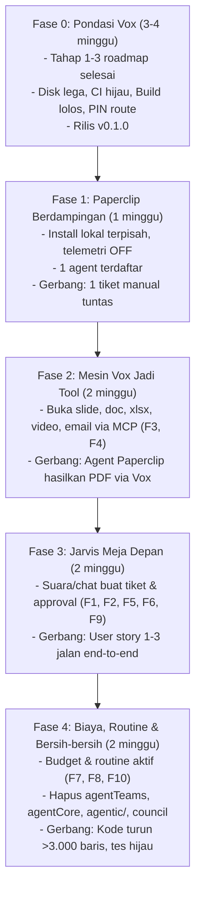

# PRD Fusi Vox Omong × Paperclip

*Nov 15, 2026 · @Diki Hadinata*

---

## 1. Ringkasan

Vox Omong menjadi "meja depan" bersuara untuk perusahaan agent ala Paperclip. Pengguna cukup ngomong atau chat ke Jarvis, lalu Jarvis mengubahnya menjadi tiket. Agent mengerjakan tiket itu dengan mesin output Vox (slide, dokumen, video, website, email), di bawah batas biaya dan persetujuan pengguna.

**Keputusan utama:** **Paperclip dipakai sebagai control plane lewat API, bukan di-fork dan dilebur kodenya.**  
Paperclip punya 113 ribu bintang, ribuan PR, dan stack-nya berat (Postgres, pnpm monorepo). Sementara Vox sedang *feature freeze* dengan 0 tes. Meleburkan dua codebase sebesar itu akan merusak rencana pematangan.

Bonusnya, fusi ini justru **mengurangi kode Vox**. Lima sistem agent yang tumpang-tindih (`agentCore`, `agentTeams`, `agentic/`, `orchestrator`, `council`) bisa digantikan orkestrasi Paperclip. Keduanya berlisensi MIT, jadi aman digabung.

---

## 2. Kondisi Vox Omong Saat Ini

- **Kematangan:** Alpha, sekitar 4,5 dari 10.
- **Commit:** 2 commit di depan `origin/main` (`d7d76d0` roadmap).
- **Tes otomatis:** 0 file, Vitest belum dipasang.
- **CI:** Belum ada (`.github/workflows` kosong).
- **Login PIN:** Ada, tapi belum menjaga route `/api/terminal`, `/api/fs`, `/api/browser`, `/api/agent`.
- **Penyimpanan:** JSON dengan tulis atomic + backup `.bak`.
- **Kekuatan unik:** Antarmuka suara, bahasa Indonesia, mesin output nyata (slide, dokumen, xlsx, PDF, video, website, email).
- **Kelemahan terbesar:** Lima sistem agent tumpang-tindih, tanpa batas biaya dan jejak audit.

---

## 3. Nilai Tambah Paperclip untuk Vox

Paperclip adalah server Node.js + UI React yang mengatur tim agent AI seperti karyawan perusahaan via adapter (Claude Code, Codex, Gemini CLI, dsb.).

| Fitur Paperclip | Apa Gunanya | Nilai buat Vox |
|---|---|---|
| **Heartbeat** | Agent bangun saat ada tugas, pesan lanjutan, atau jadwal via antrean DB | Tinggi |
| **Budget & Hard Stop** | Biaya token dicatat per agent, proyek, tiket, model; ada rem otomatis | Sangat tinggi |
| **Atomic Checkout** | 1 tiket hanya dikerjakan 1 agent (mencegah kerja dobel) | Tinggi |
| **Tiket & Issue** | Tiket terhubung ke proyek & goal, ada komentar, lampiran, blocker | Sangat tinggi |
| **Governance** | Persetujuan, pause, reassign, stop agent; tool sensitif wajib izin | Sangat tinggi |
| **Org Chart** | Peran, atasan, izin, budget untuk manusia & agent | Sedang |
| **Goal** | Tiap tugas membawa konteks tujuan bisnis | Tinggi |
| **Routines** | Tugas berulang via cron / webhook, tiap run jadi tiket | Tinggi |
| **Skill Studio** | Skill dipasang, dites dengan input tersimpan, ada versioning | Sedang |
| **Audit Log** | Semua aksi, biaya, persetujuan tercatat permanen | Sangat tinggi |
| **MCP Tool Gateway** | Akses tool dan rahasia dibatasi per agent | Tinggi |

---

## 4. Peta Fusi (Division of Ownership)

> **Prinsip:** Vox memegang semua interaksi pengguna dan pembuatan file; Paperclip memegang pengaturan kerja agent.

| Area | Pemilik setelah Fusi | Keputusan |
|---|---|---|
| **Chat & Suara (Bahasa Indonesia)** | Vox | Tetap |
| **Telepon WhatsApp** | Vox | Tetap (eksperimental) |
| **Mesin slide, dokumen, xlsx, PDF, video, website, email** | Vox | Tetap, dibungkus jadi tool yang dipanggil agent Paperclip |
| **Tiket, goal, proyek** | Paperclip | Ambil |
| **Heartbeat & antrean kerja** | Paperclip | Ambil |
| **Budget, biaya token, hard stop** | Paperclip | Ambil; `tokenTracker` & `tokenPricing` Vox jadi pengirim data biaya |
| **Persetujuan & audit log** | Paperclip | Ambil |
| **Routines (tugas terjadwal)** | Paperclip | Ambil |
| **Org chart & divisi** | Paperclip | Ganti `agentTeams.ts` (~2.000 baris) |
| **`agentCore`, `agentic/`, `council`** | — | Lebur atau hapus |
| **`orchestrator` (perintah berantai)** | Vox | Tetap untuk satu perintah cepat; tugas panjang dikirim ke Paperclip |
| **Skill komunitas (137 lokal + katalog)** | Keduanya | Vox tetap pakai; diekspor ke Skill Studio Paperclip belakangan |
| **Koneksi MCP & kredensial** | Paperclip | Ambil secrets per agent; Vox berhenti simpan kredensial di JSON |
| **Penyimpanan percakapan** | Vox | Tetap JSON untuk v0.1, SQLite di v0.2 |

---

## 5. Arsitektur Gabungan

```
                      [ Diki ]
                 (suara, chat, WhatsApp)
                          │
                          ▼
              ┌───────────────────────┐
              │  Jarvis (Vox Router)  │
              └───────────┬───────────┘
                          │
             ┌────────────┴────────────┐
             │ tugas pendek            │ tugas panjang
             ▼                         ▼
   ┌───────────────────┐     ┌───────────────────────────────────┐
   │ Mesin Output Vox  │     │   Paperclip Control Plane         │
   │ (MCP Tool)        │     │  - Tiket + Goal                   │
   │ - Slide, Dokumen  │     │  - Heartbeat + Budget             │
   │ - XLSX, Video     │     │  - Persetujuan + Audit Log        │
   │ - Website, Email  │     └─────────────────┬─────────────────┘
   └─────────▲─────────┘                       │
             │                   membangunkan  │
             └─────────────────────────────────┴─── [ Agent Pekerja ]
                      memanggil tool          (Claude Code, Gemini CLI, dll.)
```

*Tugas pendek langsung diselesaikan mesin Vox. Tugas panjang menjadi tiket Paperclip, lalu agent pekerja memanggil mesin Vox sebagai tool, dan status serta persetujuan kembali ke Diki lewat Jarvis.*

---

## 6. Kebutuhan Fungsional & Non-Fungsional

### Kebutuhan Fungsional
- **F1:** Jarvis mendeteksi tugas panjang dan membuat tiket Paperclip dengan judul, deskripsi, dan goal (*Wajib*).
- **F2:** Tugas pendek (satu file) tetap dikerjakan langsung oleh Vox tanpa tiket (*Wajib*).
- **F3:** Mesin output Vox tersedia sebagai tool yang bisa dipanggil agent Paperclip via MCP / HTTP adapter (*Wajib*).
- **F4:** Hasil file dari mesin Vox dilampirkan ke tiket sebagai work product (*Wajib*).
- **F5:** Status tiket dan biaya bisa ditanyakan lewat suara dan chat (*Wajib*).
- **F6:** Permintaan persetujuan dari Paperclip muncul di Vox (chat, suara, WhatsApp) dan bisa dijawab di sana (*Wajib*).
- **F7:** Budget bulanan per proyek diatur dari Settings Vox (*Penting*).
- **F8:** Routine dibuat dari kalimat biasa ("tiap Senin jam 8...") (*Penting*).
- **F9:** Kalau Paperclip mati, Vox tetap jalan untuk tugas pendek dan memberi pesan jelas (*Wajib*).
- **F10:** Pemetaan biaya token dari model gratis (Gemini, FreeLLMAPI) ke laporan biaya Paperclip (*Bagus kalau ada*).

### Kebutuhan Non-Fungsional
- **Keamanan:** Semua route Vox dijaga PIN, terutama `/api/terminal`, `/api/fs`, `/api/browser`, `/api/agent`. Token Paperclip disimpan di `.env.local`.
- **Ringan:** Paperclip jalan sebagai proses terpisah (Postgres bawaan). Vox tidak menanggung dependensi beratnya.
- **Tahan Gagal:** Panggilan ke Paperclip memiliki timeout dan pesan error yang ramah pengguna.
- **Teruji:** Tiap kebutuhan wajib punya automated test (mock Paperclip API) dan lolos CI.

---

## 7. Rencana Rilis & Gerbang Sukses (Fase 0 s/d Fase 4)

> ⚠️ **Aturan Ketat:** Fusi baru dimulai setelah Vox `v0.1.0` (Tahap 1–3 roadmap selesai).



---

## 8. Metrik Sukses

| Metrik | Target |
|---|---|
| Perintah suara yang berhasil jadi tiket dengan goal yang benar | ≥ 8 dari 10 perintah uji |
| Tiket yang selesai tanpa campur tangan manual (selain approval) | ≥ 70% |
| Biaya bulanan yang melewati budget | 0 kejadian |
| Kerja dobel pada tiket yang sama | 0 kejadian |
| Baris kode sistem agent di Vox | Turun dari ~5.000 ke < 1.500 baris |
| Waktu dari perintah suara sampai tiket terbuat | < 5 detik |
